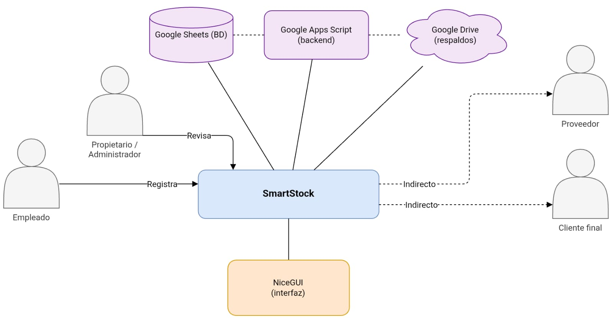
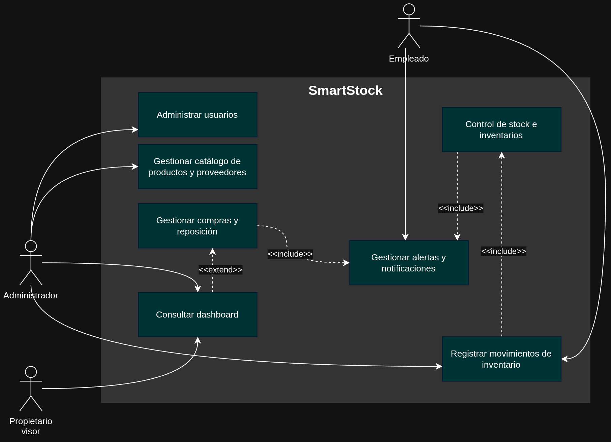
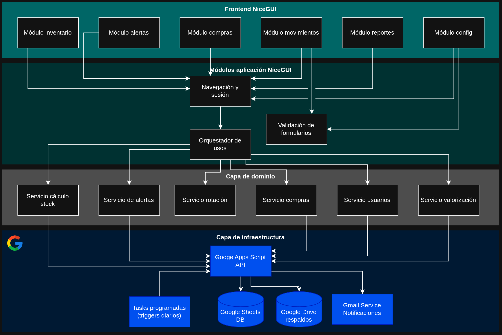
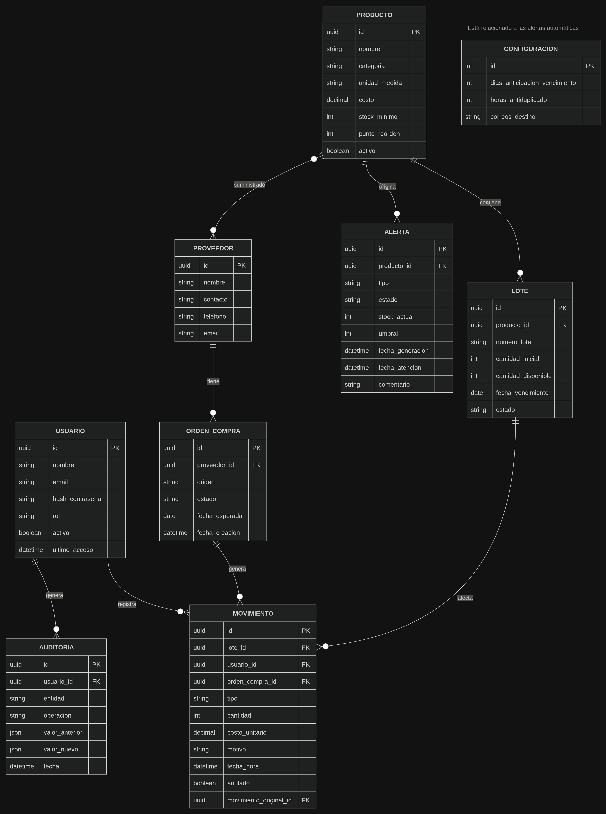
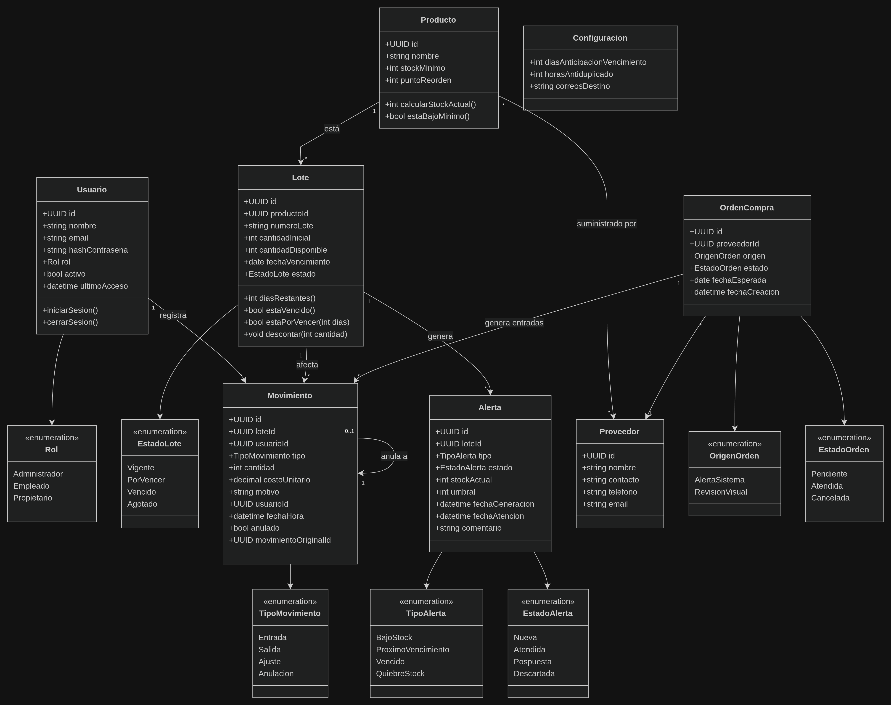
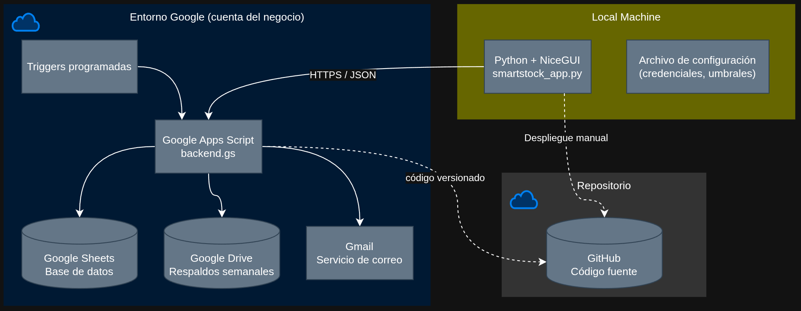
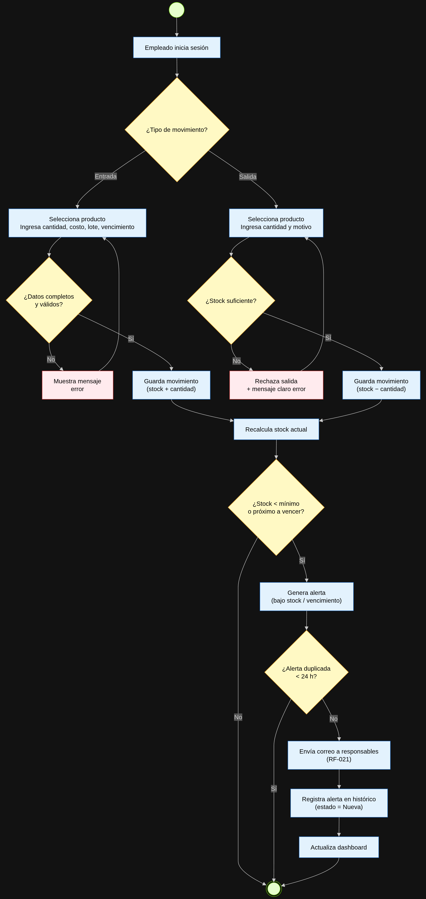
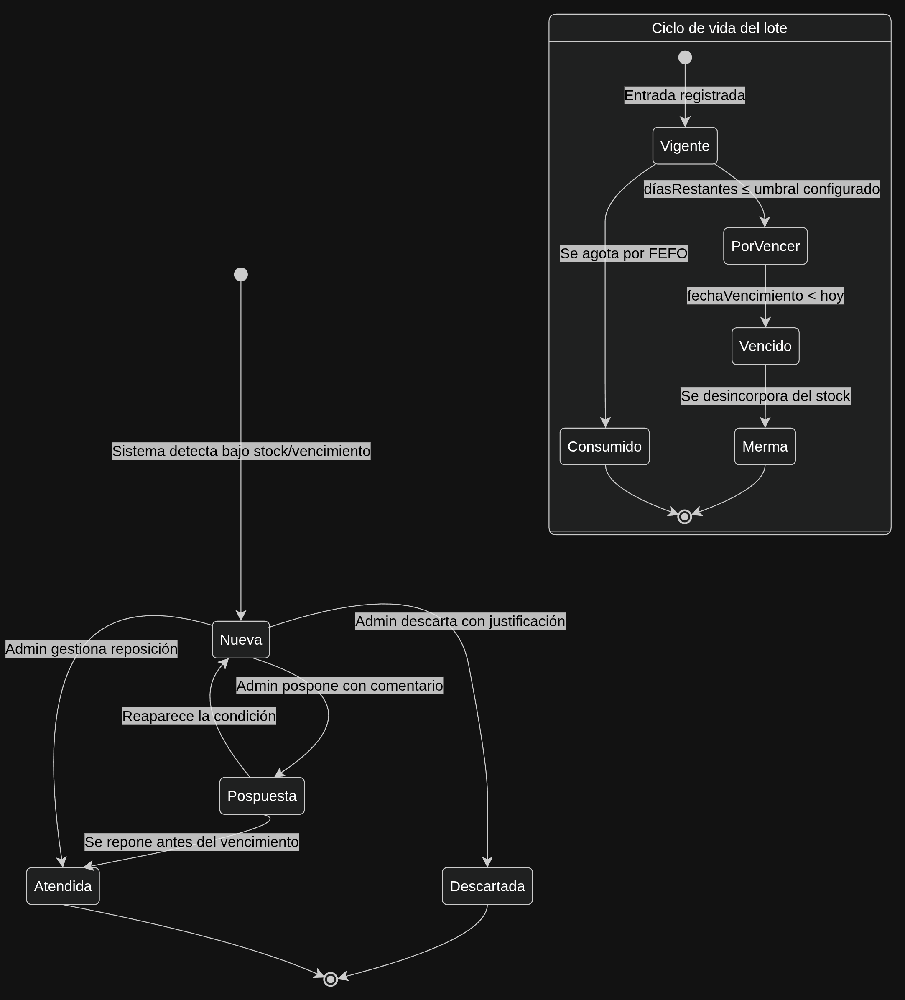
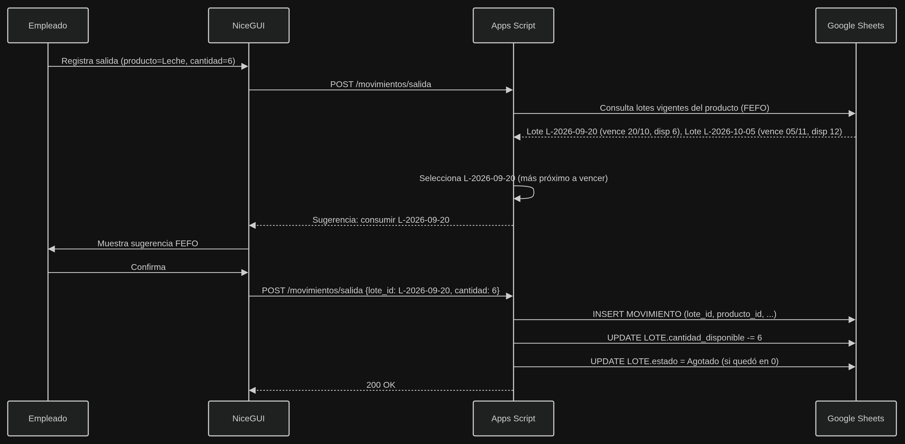
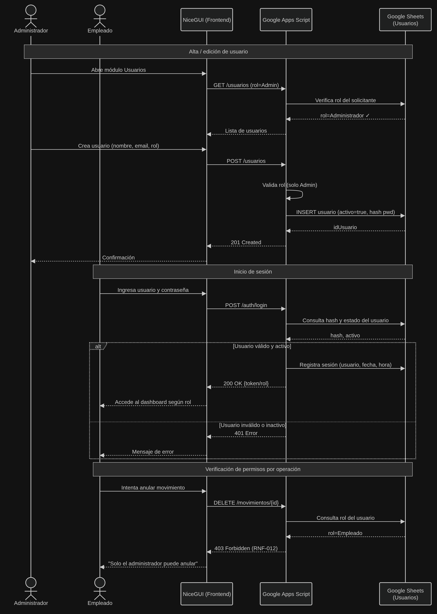

# SmartStock – Diagramas UML

Documentación de los diagramas de análisis y diseño del sistema **SmartStock**. Los archivos fuente editables (`.drawio`) se encuentran en [`UML/Drawio/`](UML/Drawio/).

---

## 1. Diagrama estructural (contexto del sistema)

Ofrece una vista general de SmartStock en su entorno: los actores que interactúan con él (Empleado que registra, Propietario/Administrador que revisa, y Proveedor y Cliente final de forma indirecta) y los elementos tecnológicos que lo soportan (Google Sheets como BD, Google Apps Script como backend, Google Drive para respaldos y NiceGUI como interfaz).

## 2. Diagrama de casos de uso

Presenta las funcionalidades del sistema desde el punto de vista de sus actores (Administrador, Empleado y Propietario visor): administrar usuarios, gestionar el catálogo de productos y proveedores, gestionar compras y reposición, registrar movimientos de inventario, gestionar alertas y notificaciones, y consultar el dashboard, incluyendo sus relaciones `<<include>>` y `<<extend>>`.

## 3. Diagrama de componentes

Muestra la organización interna del software en capas: el frontend NiceGUI con sus módulos (inventario, alertas, compras, movimientos, reportes y configuración), la navegación y sesión, la validación de formularios y el orquestador de casos de uso; la capa de dominio con los servicios de cálculo de stock, alertas, rotación, compras, usuarios y valorización; y la capa de infraestructura con la API de Google Apps Script, los triggers programados, Google Sheets, Google Drive y Gmail.

## 4. Diagrama entidad–relación

Modela los datos persistidos en Google Sheets: las entidades `PRODUCTO`, `LOTE`, `MOVIMIENTO`, `ALERTA`, `ORDEN_COMPRA`, `PROVEEDOR`, `USUARIO`, `AUDITORIA` y `CONFIGURACION`, con sus atributos, claves primarias y foráneas, y las relaciones que las vinculan (un producto contiene lotes, un lote afecta movimientos, un usuario registra movimientos, etc.).

## 5. Diagrama de clases

Define las clases principales del dominio (`Producto`, `Lote`, `Movimiento`, `Alerta`, `OrdenCompra`, `Proveedor`, `Usuario` y `Configuracion`) con sus atributos, operaciones y relaciones, junto con las enumeraciones que regulan el comportamiento del sistema (`Rol`, `EstadoLote`, `TipoMovimiento`, `TipoAlerta`, `EstadoAlerta`, `OrigenOrden` y `EstadoOrden`).

## 6. Diagrama de despliegue

Ilustra cómo se distribuye el sistema en sus nodos de ejecución: el entorno de Google de la cuenta del negocio (backend en Apps Script, Google Sheets como base de datos, respaldos semanales en Drive, servicio de correo Gmail y triggers programados), la máquina local con la aplicación Python + NiceGUI y su archivo de configuración, y el repositorio de GitHub que alberga el código fuente.

## 7. Diagrama de actividad – Movimientos y alertas

Describe el flujo paso a paso del registro de movimientos de inventario por parte del empleado: elección del tipo de movimiento (entrada o salida), validación de datos y de stock disponible, recálculo del stock actual y generación automática de alertas (bajo stock o vencimiento próximo), evitando duplicados en 24 h y notificando por correo antes de actualizar el dashboard.

## 8. Diagrama de estados – Ciclo de vida del stock y alertas

Representa las máquinas de estado de dos elementos clave: el **ciclo de vida del lote** (`Vigente` → `PorVencer` → `Vencido` → `Merma`, o `Consumido` al agotarse por FIFO) y el **ciclo de vida de las alertas** (`Nueva` → `Atendida`, `Pospuesta` o `Descartada`), con los eventos y condiciones que provocan cada transición.

## 9. Diagrama de secuencia – Salida de stock con rotación FEFO

Describe el flujo completo de una salida de inventario: el empleado solicita la salida, el backend consulta los lotes vigentes del producto, sugiere el lote más próximo a vencer (criterio FEFO, variante de FIFO priorizada por vencimiento) y, tras la confirmación, registra el movimiento, descuenta la cantidad disponible del lote y actualiza su estado si queda agotado.

## 10. Diagrama de secuencia – Registro de usuarios y sesión

Detalla la interacción entre actores, frontend NiceGUI, backend Apps Script y Google Sheets en tres escenarios: el alta/edición de usuarios por el administrador (con verificación de rol), el inicio de sesión del empleado (con token y acceso al dashboard según rol, o mensaje de error si el usuario es inválido) y la verificación de permisos por operación (por ejemplo, el rechazo de una anulación de movimiento intentada por un empleado).
